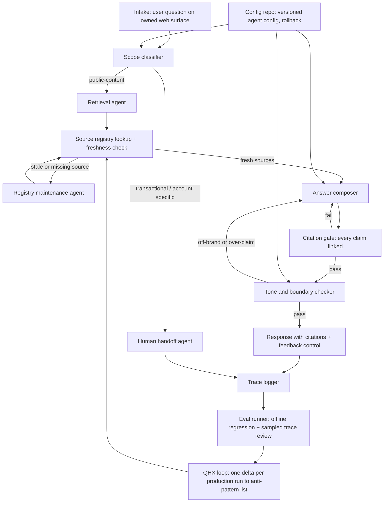

# Keiki agent harness

> AI-generated from public information for a demo engagement. Not commissioned by the company. Targets are targets, not results.

## Purpose

This document specifies a harness design for a customer-facing agent that delivers the Top 5 launch decisions for Keiki (onkeiki.com), based on public pages only. The harness is the scaffolding around the agent: the roles, tools, state, workflow, guardrails, and evaluation loop that let a product team ship a scoped public-web help agent and then improve it safely.

The client problem: a product team wants a customer-facing agent and needs to decide which channels Keiki should answer first and which artifacts the team needs to launch that agent. The harness answers both by making the v1 channel decision explicit (owned public web/help surface, public-content questions only) and by treating the five launch artifacts — channel scope with human handoff, source registry and citation contract, versioned config with rollback, written eval plan with thresholds, and role/tone/escalation artifacts — as launch-blocking gates.

Targets below are labeled as targets, not results. No customers, metrics, or quotes are invented; company facts are drawn from public pages only.

## Architecture

The harness is a supervisor pattern: a deterministic orchestrator drives a fixed workflow, delegating to narrow agents, each backed by allowlisted tools and MCP servers. All state is persisted in a typed run record; all artifacts are versioned in a config repo; all answers pass a citation gate before delivery.



## Agents and roles

| Agent | Role | Inputs | Outputs | Human owner |
|---|---|---|---|---|
| Orchestrator | Drives workflow, enforces gates, writes run record | Question, config version | Ordered step execution, run state | Platform engineer |
| Scope classifier | Labels question public-content vs transactional/account-specific | Question, scope charter | Scope label + confidence | Product owner |
| Retrieval agent | Fetches candidate passages from indexed public pages only | Question, registry entries | Ranked passages with canonical URLs | Knowledge editor |
| Registry maintenance agent | Detects page changes, flags stale entries, drafts re-index triggers | Crawl diffs, freshness SLA | Registry deltas, re-index tickets | Knowledge editor |
| Answer composer | Drafts answer strictly from retrieved passages, in approved tone | Passages, tone guide | Draft answer with inline citations | Content lead |
| Citation gate | Verifies every claim maps to a registry URL; blocks uncited claims | Draft, registry | Pass/fail + defect list | Platform engineer |
| Tone and boundary checker | Checks register against tone guide and escalation matrix | Draft, tone guide, boundary matrix | Pass/fail + rewrite notes | Content lead |
| Human handoff agent | Packages out-of-scope questions into a handoff summary | Question, run context | Handoff record for human queue | Support lead |
| Eval runner | Runs golden set and regression suite on every config/content change | Eval plan, traces | Scores vs thresholds, release recommendation | QA owner |

## Tools and MCP servers

- **Web crawl and index MCP server** — allowlisted to Keiki's own public domains; produces page snapshots, hashes, and change events feeding the registry.
- **Source registry MCP server** — CRUD over registry entries (owner, canonical URL, freshness SLA, last-verified timestamp); read-only for the retrieval agent.
- **Config repo MCP server** — reads the pinned, versioned agent config; write access restricted to the release agent path with changelog enforcement.
- **Secrets manager integration** — chat-only scoped credentials; no transactional scopes at v1.
- **Trace store and eval harness** — append-only run traces, golden set storage, score reporting.
- **Ticket queue connector** — creates handoff records and registry maintenance tickets.
- **Feedback control** — thumbs up/down plus "was this answered from the linked page?" on every response.

## Skills

- **keiki-public-web-agent-launch** — encodes the v1 channel decision (owned public web/help surface, public-content only), the hard human handoff boundary, and the launch-blocking artifact checklist.
- **keiki-source-registry-citations** — builds and maintains the source-of-truth registry, enforces the citation-required answer contract, and runs the crawl/index pipeline with change detection and re-index triggers.
- **keiki-agent-config-and-evals** — authors the single versioned, schema-validated config with pinned model, feature toggles, environment-scoped gateway settings, tested rollback, and the written eval plan with numeric thresholds and sampled trace review.

## State schema

```yaml
run:
  run_id: string
  config_version: string          # pinned; rollback target recorded
  channel: "owned_web_help"       # v1 only
  question: string
  scope_label: enum[public_content, transactional, account_specific, ambiguous]
  retrieved:
    - url: string                 # must exist in registry
      registry_id: string
      last_verified: date
      freshness_ok: bool
  draft: string
  citations: [registry_id]
  gates:
    citation_gate: enum[pass, fail]
    tone_gate: enum[pass, fail]
    boundary_gate: enum[pass, fail]
  outcome: enum[answered, handed_off, refused_with_reason]
  handoff_record_id: string?
  feedback: {vote: enum[up, down]?, source_confirmed: bool?}
  trace_ref: string
anti_pattern_list:
  - id: string
    pattern: string
    discovered_in_run: string
    delta: string                 # exactly one per production run
    status: enum[open, mitigated, closed]
```

## Workflow

1. Intake question from the owned web surface; pin config version and open run record.
2. Scope classifier labels the question. Transactional or account-specific → handoff agent, outcome `handed_off`, run closes with trace.
3. Retrieval agent queries only registry-listed pages; freshness check per SLA. Stale or missing → registry maintenance agent flags and either re-indexes or the answer proceeds with a staleness note.
4. Answer composer drafts strictly from retrieved passages with inline citations.
5. Citation gate blocks any uncited claim; failures return to composer (max 2 retries, then handoff).
6. Tone and boundary checker validates register and escalation rules; failures return to composer.
7. Response delivered with citations and feedback control; trace logged.
8. Eval runner scores the run against the eval plan; QHX loop writes exactly one delta to the anti-pattern list.

## Guardrails and anti-patterns

Guardrails:
- Public-content only at v1; no account lookups, orders, or transactions.
- Citation required: no answer ships without a registry-linked source per claim.
- Hard human handoff on out-of-scope, low-confidence, or repeated gate failure.
- Pinned model and config; every change ships with changelog and tested rollback.
- Chat-only scoped credentials in the secrets manager.
- Refusal with reason beats a confident guess.

Anti-patterns (seeded; QHX appends one per production run):
- Answering from model memory when retrieval returns nothing.
- Citing a page that is stale past its freshness SLA without a staleness note.
- Scope creep into account-specific answers mid-conversation.
- Tone drift toward over-claiming ("definitely", "guaranteed") without a source.
- Silent config edits without changelog or rollback test.
- Eval thresholds loosened to make a release pass.

## Evals

Offline (pre-release, every prompt/model/content change):
- Golden set seeded from public pages plus labeled paraphrases, including adversarial out-of-scope questions.
- Pass criteria (targets): groundedness ≥ 95% of answers fully cited; refusal correctness ≥ 90% on out-of-scope set; boundary adherence 100% (zero transactional answers); correct escalation ≥ 95%; tone rubric pass ≥ 90%; regression suite zero regressions vs prior version.
- Sampled trace review: human review of a fixed sample per release against the rubric; release blocked on any boundary breach.

Online (production):
- Feedback vote ratio and source-confirmation rate tracked per intent (targets set at launch, not asserted here).
- Weekly sampled trace review; every gate failure triaged into the anti-pattern list.
- Drift check: citation-gate failure rate and handoff rate monitored; threshold breach opens a ticket.

## QHX improvement loop

Every production run writes exactly one delta to the anti-pattern list: a named pattern, the run that surfaced it, and a proposed mitigation (prompt tweak, registry fix, threshold change, or new golden case). Deltas are triaged weekly; mitigations ship through the config repo with changelog and rollback, and closed deltas become regression cases. The loop is mandatory — a run without a delta is an incomplete run.

## Rollout plan (30/60/90 days)

- **Days 0–30:** Stand up registry, crawl/index pipeline, and config repo; write the five launch-blocking artifacts (scope charter with handoff, registry and citation contract, versioned config with rollback, eval plan with thresholds, role/tone/escalation matrix); build golden set; internal dogfood on the owned web surface.
- **Days 60:** Limited public exposure on the single owned surface, public-content only, with feedback control and weekly trace review; go-live gated on offline pass criteria; first QHX deltas expected.
- **Days 90:** Full v1 on the owned surface; decide next channel (email, in-app, social DMs) from conversation logs; knowledge maintenance and continuous evaluation loops running with human sign-off; targets reviewed against online data and reset for v2.
