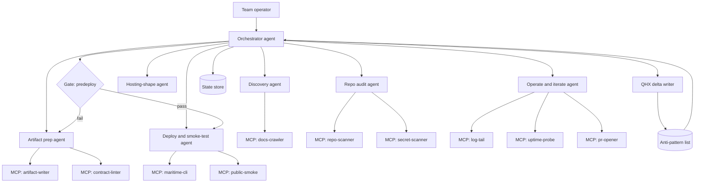

# Maritime agent harness

> AI-generated from public information for a demo engagement. Not commissioned by the company. Targets are targets, not results.

## Purpose

This document specifies a harness design for an agent system that delivers the Top 5 outcomes for a software team that already has a repository and wants Maritime (maritime.sh) to host a public web agent. The harness coordinates discovery, repository audit, hosting-shape decision, artifact generation, public deploy, and post-deploy operation. It is designed around public information about Maritime only; no customer names, metrics, or quotes are asserted. All numeric expectations are labeled **targets**.

The harness exists to make the platform/team seam explicit, make the first public deploy fail closed on missing artifacts, force a plain single-port HTTP contract, put abuse and cost controls in the team's container before `--public`, and publish one provenance-carrying access and artifact page.

## Architecture



The orchestrator is the only agent that mutates state transitions. Sub-agents are single-purpose and return structured results. The predeploy gate is a hard edge: the deploy agent cannot run until the gate returns pass. Every production run terminates by writing exactly one QHX delta.

## Agents and roles

| Agent | Type | Responsibility | Inputs | Outputs | Human checkpoint |
|---|---|---|---|---|---|
| Orchestrator | AI | Sequences stages, owns state transitions, enforces gate | Run request, state store | Stage assignments, final report | None (supervised) |
| Discovery | AI | Crawls public maritime.sh docs and pricing, extracts hosting primitives | Public URLs | Capability brief | None |
| Repo audit | Hybrid | Scans repo for entrypoints, secrets, build steps; proposes manifest skeleton | Repo snapshot | Audit report, manifest draft | Confirms secret findings |
| Hosting-shape | Hybrid | Recommends Maritime-hosted vs team-operated vs hybrid split | Capability brief, audit report | Seam decision record | **Approves tradeoffs** |
| Artifact prep | Hybrid | Generates Dockerfile, CONTRACT.md, env manifest, health check, README, rate limiter | Seam decision, audit report | Artifact PR | **Reviews secrets and public exposure** |
| Deploy and smoke-test | Hybrid | Runs predeploy gate, triggers deploy, runs public smoke tests | Passing gate, artifact PR | Live URL, smoke report | **Signs off on live URL** |
| Operate and iterate | Hybrid | Monitors logs and uptime, opens fix PRs | Live URL, log stream | Fix PRs, incident notes | Owns incident response and policy changes |

## Tools and MCP servers

- `docs-crawler` — fetches and extracts public maritime.sh pages; read-only, cached per run.
- `repo-scanner` — walks the repository tree, detects entrypoints, Dockerfiles, lockfiles, `.dockerignore`, `EXPOSE`, and listener bindings.
- `secret-scanner` — detects committed secrets and `.env` leakage; blocks on high-confidence findings.
- `artifact-writer` — writes files to a branch and opens a PR; never pushes to the default branch.
- `contract-linter` — validates `CONTRACT.md` against the actual listener, port, and health path.
- `maritime-cli` — wraps deploy, `--public` flip, and sleep/wake configuration; requires `MARITIME_TOKEN` in CI.
- `public-smoke` — issues unauthenticated requests to the live URL: `GET /health` expects 200, one request route expects a valid response shape.
- `log-tail` — streams captured logs post-deploy.
- `uptime-probe` — periodic external probe with alert threshold.
- `pr-opener` — opens fix PRs from operate stage.

All MCP servers are scoped to least privilege. `maritime-cli` is the only server with write access to the platform.

## Skills

- **maritime-deploy-manifest** — produces the committed, provenance-tagged deploy manifest with two explicit columns: what Maritime hosts (build execution, runtime, routing, TLS, sleep/wake, log capture, public URL) and what the team operates (repo, Dockerfile, entrypoint, port/env contract, health endpoint, rate limiter, idle-sleep policy). Every manifest line carries a provenance tag pointing to the public source or repo path that justifies it.
- **maritime-predeploy-gate** — converts the ordered checklist into a CI-enforced, fail-closed gate. Required in order: root-level Dockerfile with digest-pinned base image; committed lockfile; `.dockerignore` excluding `.git`, `.env`, test fixtures; declared `EXPOSE` matching the actual listener; `GET /health` returning 200; `CONTRACT.md` present and lint-clean; app-level rate limiter and input validator present; documented max-wake budget; deliberate idle-sleep configuration. Any missing item fails the gate with a named reason.
- **maritime-agent-contract** — enforces the plain single-port HTTP default: one server bound to `0.0.0.0` on a single `PORT`-configurable port, one request-handling route, and a chat contract only if the agent is conversational. Runs the one-question classifier to decide chat vs plain and records the decision in `CONTRACT.md`.

## State schema

```yaml
run_id: string
repo: {url: string, default_branch: string, commit: string}
stage: enum[discover, audit, shape, prepare, gate, deploy, operate, done, failed]
capability_brief: {primitives: [string], sources: [url]}
audit: {entrypoints: [string], secrets: [finding], build_steps: [string]}
seam_decision: {hosted: [string], operated: [string], approved_by: string, approved_at: ts}
artifacts: {dockerfile: path, contract_md: path, env_manifest: path, health: path, rate_limiter: path, pr_url: string}
gate: {status: enum[pending, pass, fail], failures: [string], checked_at: ts}
deploy: {public: bool, url: string, smoke: {health_status: int, route_status: int, passed: bool}}
operate: {log_cursor: string, uptime_state: enum[up, down], open_prs: [string]}
qhx_delta: {anti_pattern_id: string, evidence: string, proposed_change: string}
```

State is append-only per stage; transitions are validated by the orchestrator against the stage enum.

## Workflow

1. **Discover** — Discovery agent crawls public maritime.sh docs and pricing and drafts a capability brief. No repo access yet.
2. **Audit** — Repo audit agent scans the repository, flags missing entrypoints, secrets, and build steps, and proposes a manifest skeleton. Human confirms secret findings.
3. **Choose shape** — Hosting-shape agent recommends hosted vs team-operated vs hybrid split and writes the seam decision record. **Human approves tradeoffs.**
4. **Prepare artifacts** — Artifact prep agent generates Dockerfile, `CONTRACT.md`, env manifest, health check, README, and rate limiter, then opens a PR. **Human reviews secrets and public exposure.**
5. **Gate** — `maritime-predeploy-gate` runs in CI. Fail closed: any missing artifact returns to stage 4 with named failures.
6. **Deploy and smoke-test** — Deploy agent flips `--public` only after gate pass, triggers deploy, and runs public smoke tests. **Human signs off on the live URL.**
7. **Operate and iterate** — Operate agent monitors logs and uptime and opens fix PRs. Humans own incident response and policy changes.
8. **Close** — Orchestrator writes exactly one QHX delta to the anti-pattern list and emits the run report.

## Guardrails and anti-patterns

Guardrails:
- Gate is fail-closed; no manual override without a recorded reason in state.
- `--public` is flipped only by the deploy agent after gate pass and human sign-off.
- No secret values in logs; secret-scanner blocks high-confidence findings.
- Artifact writer never pushes to the default branch.
- Rate limiter and input validator must exist in the team's container before `--public`; per-IP throttling, max-wake budget, and idle-sleep configuration are gate items.
- One provenance tag per manifest line; untagged lines fail lint.
- Chat contract only if the classifier says conversational.

Anti-patterns (seeded list, extended by QHX):
- AP-001: Deploying with a floating base image tag.
- AP-002: `EXPOSE` port that does not match the listener.
- AP-003: Health endpoint that returns 200 without checking dependencies.
- AP-004: Flipping `--public` before the rate limiter ships.
- AP-005: Two onboarding documents that teams must reconcile.
- AP-006: Email verification or trial card demanded before the create command is previewed.
- AP-007: Chat contract bolted onto a non-conversational agent.
- AP-008: Undocumented max-wake budget allowing wake-on-visit cost drift.

## Evals

**Offline**
- Gate fixture suite: seeded repos with each missing artifact; gate must fail with the correct named reason. Pass criterion: 100% of fixtures fail correctly and zero false passes.
- Contract linter suite: mismatched port, missing health path, chat contract on plain agent. Pass criterion: all mismatches flagged.
- Manifest lint: untagged lines rejected. Pass criterion: 100% rejection.
- Classifier suite: labeled plain vs conversational cases. **Target:** ≥95% agreement with labels.

**Online**
- Public smoke on every deploy: `GET /health` returns 200 and the request route returns the documented shape. Pass criterion: both pass before sign-off.
- Rate limiter probe: burst above threshold returns 429. Pass criterion: 429 observed within the documented window.
- Uptime probe: alert fires within the configured threshold on simulated downtime. **Target:** alert latency under 2 minutes.
- QHX delta presence: every production run writes exactly one delta. Pass criterion: 100% of runs.

## QHX improvement loop

Every production run writes exactly one delta to the anti-pattern list before the run closes. A delta contains the anti-pattern id (existing or new), the evidence from the run, and a proposed change to a skill, gate item, or guardrail. Deltas are reviewed on a fixed cadence; accepted deltas update the seeded anti-pattern list and, where relevant, the gate fixture suite. The orchestrator reads the current anti-pattern list at run start so new entries take effect immediately. A run that cannot produce a delta is marked incomplete.

## Rollout plan (30/60/90 days)

**Days 0–30** — Stand up orchestrator, discovery, and repo audit. Ship `maritime-deploy-manifest` and the manifest lint. Seed the anti-pattern list. Run offline gate fixtures in shadow mode. **Target:** gate fixtures at 100% correct failure.

**Days 31–60** — Enable hosting-shape and artifact prep with human checkpoints. Turn on the predeploy gate as a required CI check. Ship `maritime-agent-contract` and the classifier suite. Begin online smoke and rate limiter probes. **Target:** classifier agreement ≥95%; zero false gate passes.

**Days 61–90** — Enable deploy, smoke-test, and operate stages with human sign-off. Turn on QHX delta enforcement and the review cadence. Publish the single provenance-carrying access and artifact page, GitHub-first, with browser-code CLI login for humans and `MARITIME_TOKEN` for CI. **Target:** 100% of production runs carry a QHX delta; one page replaces the two onboarding documents.
