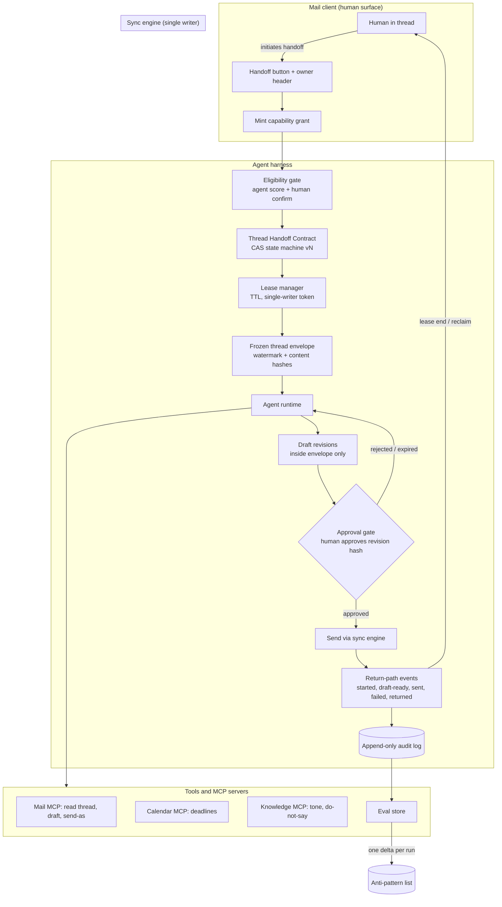

# Orchid agent harness

> AI-generated from public information for a demo engagement. Not commissioned by the company. Targets are targets, not results.

## Purpose

This document specifies a harness design for an agent that can take over an email thread on behalf of a human, built for the product surface described publicly by Orchid (orchid.ai, formerly Zero and Mail0). The harness exists to answer one question safely: **how does a thread move from human-owned to agent-held and back without dropping the conversation?**

The design treats handoff as a first-class, versioned, auditable state transition rather than a background action. It is organized around five artifacts, in priority order:

1. A versioned **Thread Handoff Contract** with a CAS-guarded state machine.
2. A **lease-return-path** owned by the sync engine, keyed by thread ID.
3. **Frozen-envelope approval** bound to a revision hash, draft-only by default.
4. A thread-local, time-boxed **capability grant** with a mandatory send gate.
5. **Visible ownership state** in the thread header plus an append-only audit trail.

All numbers below are labeled **targets**, not results. No customer names, metrics, or quotes are claimed beyond what is publicly visible; where public information is thin, the design states its assumptions.

## Architecture

The harness sits between the mail client, the sync engine, and one or more agents. The sync engine is the single writer of thread state; agents act only through the harness against a thread ID.



Key invariants:

- The client hands over **by thread ID, not by copy**. The agent never holds a divergent copy of the conversation.
- Every state transition is CAS-guarded on a monotonically increasing `state_version`; a stale writer loses.
- The lease is owned by the sync engine, not the agent. Lease expiry returns the thread to the human automatically.
- Nothing leaves draft state without a human approval bound to a specific revision hash.

## Agents and roles

| Role | Type | Responsibility | May write | Must escalate when |
|---|---|---|---|---|
| Eligibility scorer | AI agent | Scores thread for agent-fit; proposes handoff | Score record only | Score below threshold |
| Handoff confirmer | Human | Confirms or overrides eligibility; signs first-contact per account | Grant record | First contact on a new account |
| Packet assembler | AI agent | Builds handoff packet: summary, intent, open questions, constraints, tone, deadlines, do-not-say list | Packet (immutable once sealed) | Intent ambiguous |
| Permission checker | Hybrid | Verifies send-as identity, recipient scope, approval level | Check result | Identity or scope mismatch |
| Thread agent | AI agent | Replies in-thread inside envelope; preserves quoting and subject | Draft revisions only | Low confidence, new intent, envelope breach |
| Approver | Human | Approves a specific revision hash or rejects | Approval record | — (is the gate) |
| Auditor / reclaimer | Human | Reviews audit trail; one-click reclaim | Reclaim event | Any anomaly |
| Eval miner | AI agent | Mines handoffs for failures; proposes schema/prompt/escalation updates | Delta to anti-pattern list | — |

Separation of duties: the thread agent can never approve its own revision, and the eligibility scorer can never mint a grant.

## Tools and MCP servers

- **Mail MCP server** — `read_thread(thread_id, watermark)`, `create_draft(thread_id, revision)`, `send_draft(thread_id, revision_hash, grant_id)`, `apply_label`, `propose_archive`. Send is rejected unless the revision hash matches an approval record and the grant is unexpired.
- **Calendar MCP server** — read-only deadline lookup for packet assembly.
- **Knowledge MCP server** — tone guides, per-account do-not-say lists, prior packet schemas.
- **Eval store** — offline fixtures and online trace sink; append-only.
- **Audit log** — append-only, hash-chained; every tool call and transition lands here before its effect is visible.

All tool calls carry `(thread_id, lease_id, state_version)`; the MCP layer enforces the single-writer token so a reclaimed thread's stale agent cannot write.

## Skills

Three skills are mandatory and versioned alongside the contract:

- **thread-handoff-contract** — Encodes the state machine (`unassigned -> offered -> agent-held -> awaiting-approval -> returned | reclaimed | failed`), the CAS rules, and the contract schema version. Any agent or service that touches thread state loads this skill first; it refuses transitions that skip the approval gate or reuse a stale `state_version`.
- **lease-return-path** — Implements lease acquisition, TTL renewal, and the return-path event vocabulary (`started`, `draft-ready`, `sent`, `failed`, `returned`) keyed by `(thread_id, lease_id)`. Guarantees that lease expiry emits `returned` and flips ownership back to the human even if the agent dies silently.
- **frozen-envelope-approval** — Builds the frozen envelope (participants, ordered message-ID set with watermark, attachments, labels, stated intent), hashes it, and binds approvals to draft revision hashes inside it. Rejects any draft that references messages beyond the watermark or alters quoting.

## State schema

Single versioned record per thread, stored by the sync engine:

```json
{
  "schema_version": "thc/1",
  "thread_id": "immutable",
  "state_version": 0,
  "state": "unassigned | offered | agent-held | awaiting-approval | returned | reclaimed | failed",
  "owner": {"type": "human | agent | none", "id": "..."},
  "grant": {"grant_id": "...", "grantor": "...", "scopes": ["read_thread","draft_reply","apply_label","propose_archive"], "expires_at": "..."},
  "lease": {"lease_id": "...", "ttl_s": 0, "renewed_at": "...", "single_writer_token": "..."},
  "envelope": {"envelope_hash": "...", "watermark_message_id": "...", "participants": [], "attachment_hashes": [], "labels": [], "stated_intent": "..."},
  "approval": {"revision_hash": "...", "approver": "...", "approved_at": "..."},
  "events": [{"seq": 0, "type": "...", "actor": "...", "content_hash": "...", "at": "..."}]
}
```

Rules: `thread_id` immutable; `events` append-only with content hashes; `state_version` increments on every transition and is the CAS guard; `approval.revision_hash` must match the draft being sent; a lease without a live grant is invalid.

## Workflow

1. **Eligibility gate (hybrid).** Scorer proposes; human confirms or overrides. No state change without confirmation.
2. **Handoff packet (agent).** Packet assembler seals an immutable packet inside the envelope.
3. **Permission and identity check (hybrid).** Verify send-as identity and recipient scope; human signs off on first contact per account.
4. **Grant and lease.** Client mints the thread-local grant; sync engine issues the lease with TTL and single-writer token; state moves `offered -> agent-held` via CAS.
5. **Agent acts.** Thread agent drafts revisions inside the envelope, preserving quoting and subject; emits `started` and `draft-ready`.
6. **Approval gate.** Human approves a revision hash; state moves to `awaiting-approval -> sent`; `send_draft` verifies hash and grant.
7. **Return or reclaim.** On completion, failure, or TTL expiry, the lease-return-path emits `returned` and ownership flips to the human; a human can reclaim at any time with one click.
8. **Audit and eval.** Every transition is logged with rationale; the eval miner diffs draft vs sent and writes one delta to the anti-pattern list.

## Guardrails and anti-patterns

Guardrails:

- Draft-only by default; send requires a hash-bound human approval and a live grant.
- Single writer per thread enforced by lease token; stale writes rejected on `state_version`.
- Envelope freeze: no new participants, attachments, or messages beyond the watermark without re-freezing and re-approval.
- TTL expiry always returns the thread; no silent agent persistence.
- Ownership state rendered in the thread header at all times; no background takeovers.
- One-click human reclaim preempts the agent immediately.

Anti-patterns the harness must refuse:

- Handing over a **copy** of the thread instead of the ID.
- Account-wide agent tokens instead of per-thread grants.
- Approval bound to "the draft" rather than a revision hash.
- Agents that can extend their own lease indefinitely.
- Hidden ownership changes with no header state.
- Sending on low confidence without escalation.
- Audit entries written after the effect instead of before.

## Evals

**Offline** (fixtures replayed against the harness):

- CAS race: two writers, one stale — stale write must fail. Pass: 100% rejection of stale `state_version`.
- Lease expiry mid-draft: `returned` emitted, ownership flipped, no orphan draft sent. Pass: 100%.
- Envelope breach: draft referencing post-watermark message rejected. Pass: 100%.
- Approval mismatch: send with wrong revision hash rejected. Pass: 100%.
- Reclaim during send: human wins, agent notified. Pass: 100%.
- Packet quality rubric (intent, constraints, do-not-say present). Pass target: ≥ 90% of fixtures score full marks.

**Online** (production traces, sampled):

- Handoff completion without drop: thread returns to human with conversation intact. Target: ≥ 99%.
- Approval-gate integrity: zero sends without matching approval record. Target: 100%.
- Escalation precision on low confidence / new intent. Target: ≥ 95% recall on labeled traces.
- Time-to-reclaim under one click. Target: p95 < 2 s.
- Audit completeness: every transition has a pre-effect log entry. Target: 100%.

## QHX improvement loop

Every production run writes exactly **one delta** to the anti-pattern list — a single, specific, testable addition (e.g., "agent renewed lease past grant expiry," "packet omitted do-not-say on forwarded threads"). The eval miner drafts the delta, a human ratifies it, and the next offline fixture set includes a regression case for it. The anti-pattern list is versioned with the contract; a delta that recurs twice triggers a schema or skill revision, not just a prompt tweak.

## Rollout plan

**Days 0–30.** Ship the Thread Handoff Contract v1 and CAS state machine behind a flag; internal threads only. Build the audit log and header ownership state. Offline evals green on CAS, expiry, and approval mismatch.

**Days 31–60.** Enable lease-return-path and frozen-envelope-approval for a small internal cohort; draft-only, human approves every send. Start the QHX loop; ratify the first anti-pattern deltas. Target: zero approval-gate violations.

**Days 61–90.** Open handoff to external recipients on opted-in accounts with first-contact human sign-off; enable one-click reclaim and online eval sampling. Review contract at v1.x with deltas folded in. Targets by day 90: ≥ 99% drop-free handoffs, 100% approval integrity, p95 reclaim < 2 s — all targets, not results.

*Sources: public pages of orchid.ai only. This document does not claim Orchid commissioned the work.*
